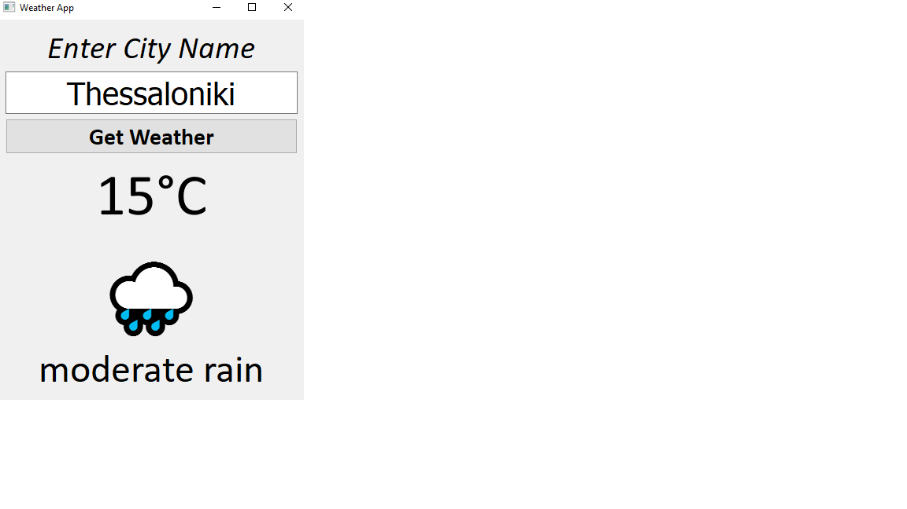

# PyQt5 Weather App 🌤️

A weather application built with Python and PyQt5, using the OpenWeatherMap API to display real-time weather information for different cities.

## About the Project

This project allows users to enter a city name and retrieve its current weather conditions through the OpenWeatherMap API. The application displays the temperature in Celsius, a weather emoji, and a description of the current conditions.

## Features

- Search for weather information by city name
- Display temperature in Celsius
- Weather emojis based on weather conditions
- Weather descriptions
- Error handling for invalid cities and connection problems
- Graphical user interface built with PyQt5

## Technologies Used

- Python 3
- PyQt5
- Requests
- OpenWeatherMap API
- python-dotenv

## Requirements

```bash
pip install PyQt5 requests python-dotenv
```

## Setup and Usage

1. Clone this repository or download the source code.
2. Create a `.env` file in the project folder.
3. Add your OpenWeatherMap API key:

```env
API_KEY=your_api_key_here
```

4. Run the application:

```bash
python weather_app.py
```

5. Enter a city name and click **Get Weather**.

## Screenshot



## Author

**Lazaros**

GitHub: [@lazakour](https://github.com/lazakour)
